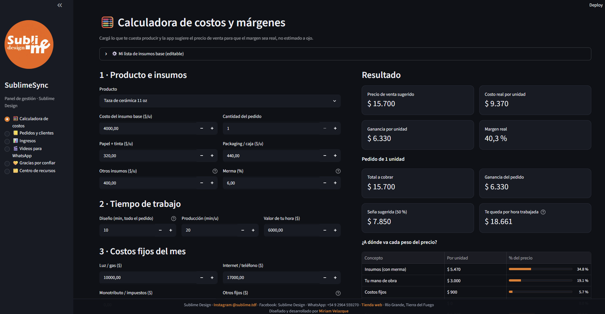
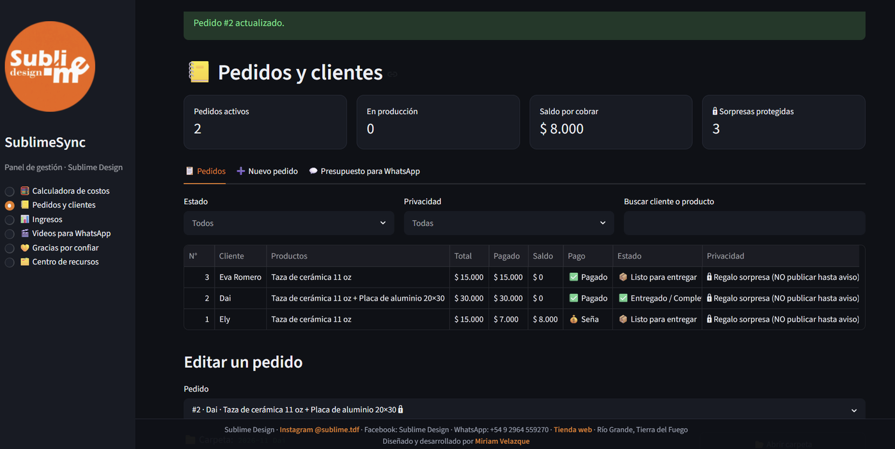
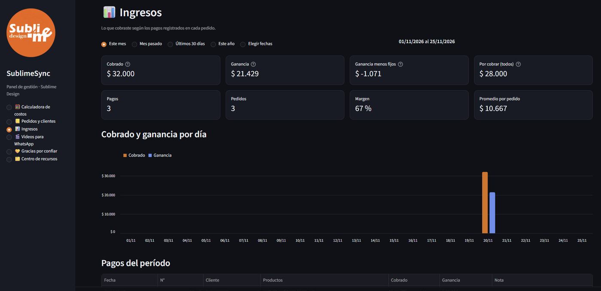
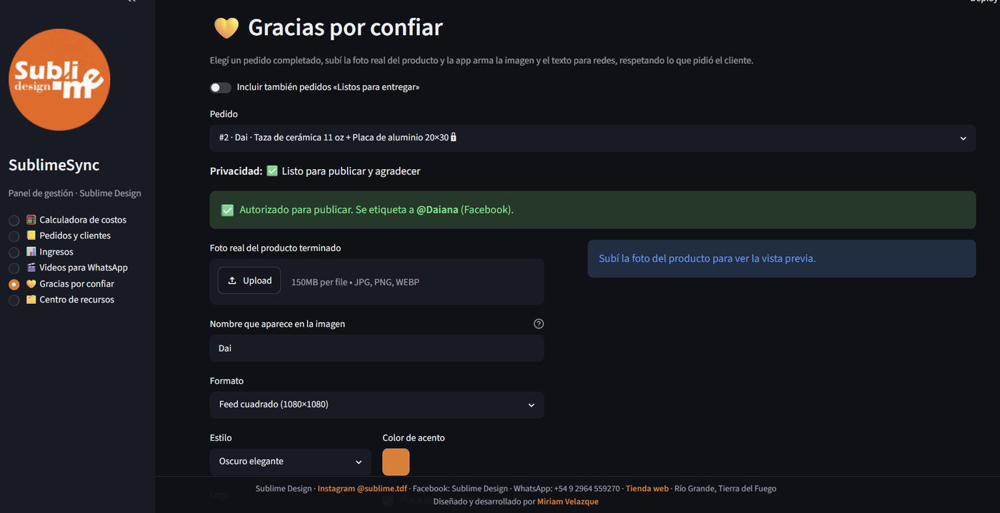
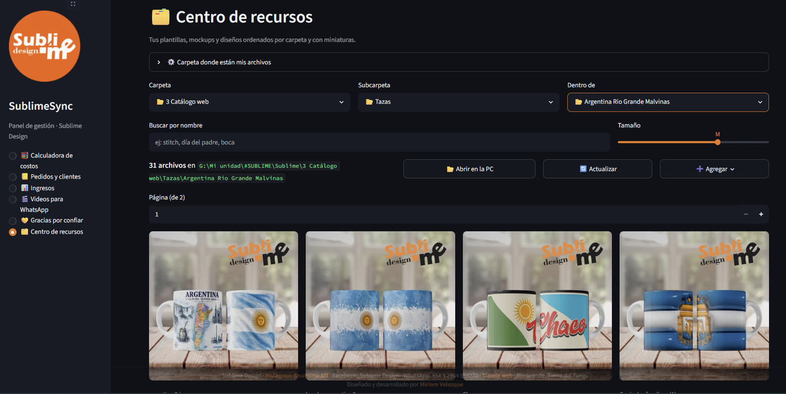

# 🎨 SublimeSync: panel de gestión para Sublime Design

Aplicación web que desarrollé para gestionar mi emprendimiento de productos sublimados ([@sublime.tdf](https://www.instagram.com/sublime.tdf/), Río Grande, Tierra del Fuego). Reúne en un solo lugar los costos, los pedidos, los cobros, las publicaciones de agradecimiento y los recursos de diseño.

> 🔒 **Código privado.** Herramienta interna en uso real. Este repositorio muestra la aplicación; el código está disponible para revisión en entrevistas técnicas.

---

## ✨ Módulos

- **Calculadora de costos y márgenes:** insumos, merma, tiempo de diseño y producción, costos fijos del mes y comisión de cobro. Sugiere el precio de venta según el margen real o el recargo deseado, muestra a dónde va cada peso del precio y calcula la seña.
- **Pedidos y clientes:** pedidos con varios productos, pagos parciales, estados de producción, fecha de entrega y una carpeta por pedido. Cada pedido lleva una **regla de privacidad** (por ejemplo, *regalo sorpresa*) que bloquea su publicación hasta que el cliente lo autorice. También genera presupuestos para WhatsApp.
- **Ingresos:** cobrado, ganancia, ganancia menos costos fijos, saldo por cobrar y margen, con filtros por período y gráfico diario.
- **Gracias por confiar:** a partir de la foto real del producto terminado, arma la imagen y el texto para redes, etiquetando al cliente solo si lo autorizó.
- **Videos para WhatsApp:** convierte los mockups en video a un formato compatible.
- **Centro de recursos:** explorador de plantillas, mockups y diseños sincronizados desde Google Drive, con miniaturas, búsqueda y filtros por carpeta.

## 🛠️ Tecnologías

Python · Streamlit · SQLite · Pillow · pandas · imageio-ffmpeg · Google Drive para escritorio

---

## 📸 Capturas

| Calculadora de costos y márgenes | Pedidos con regla de privacidad |
|---|---|
|  |  |
| **Ingresos y ganancia** | **Publicación de agradecimiento autorizada** |
|  |  |
| **Centro de recursos** | |
|  | |

---

## 👩‍💻 Autora

**Miriam Alicia Velazque**: diseño y desarrollo.
[LinkedIn](https://www.linkedin.com/in/miriam-alicia-velazque) · [GitHub](https://github.com/miriamvelazque)
